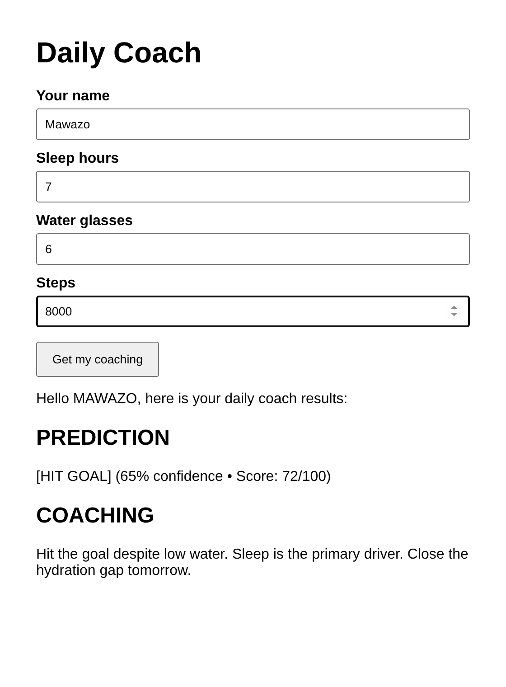
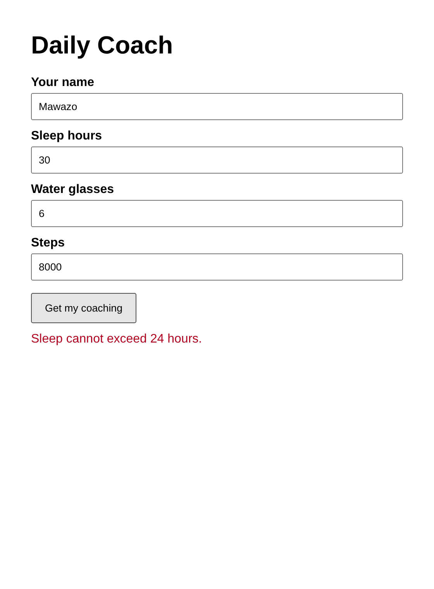

# Daily Coach

A small web tool that takes your daily **sleep, water and step count**, predicts whether you hit your daily goal, and gives you a short coaching message, all on one page with no reload.



## What does it do?

1. You enter your name, hours of sleep, glasses of water and steps.
2. The page sends those numbers to a Python (Flask) server.
3. The server scores your day out of 100, decides if you hit the goal, works out a confidence percentage and picks a two-sentence coaching message.
4. The page shows the result straight away.

**The scoring rule**

```
score = min(sleep / 8, 1) * 35
      + min(water / 10, 1) * 25
      + min(steps / 12000, 1) * 40

hit goal   = score >= 60
confidence = min(0.50 + abs(score - 60) * 0.012, 0.95)
```

Each habit is capped at its own goal, so extra steps can't make up for missing sleep beyond that habit's weight. The coaching message is chosen from 8 rule-based cases, depending on whether you hit the goal, slept at least 7 hours, and drank at least 8 glasses.

## Why does it exist?

This is a Week 8 project from an AI Masterclass, on JavaScript and browser tools. The brief was to build a complete browser tool that accepts daily inputs, runs a rule-based prediction, generates a coaching message, and shows results in a live UI without a page reload.

I first built it fully in the browser (https://mawazob.github.io/daily-coach/). This repo is the second version, where the logic moves to a Python Flask backend and the page talks to it with the JavaScript Fetch API. That practises how a front end and a back end work together: JSON requests, input validation on both sides, and CORS.

There is no machine learning here. The "prediction" is a transparent set of rules, which makes it easy to read and change.

## How do you run it?

**You need:** Python 3.9+, a browser, and VS Code with the Live Server extension (or any static file server).

**1. Start the backend.** In a terminal inside the project folder:

```powershell
python -m venv venv
venv\Scripts\activate
pip install -r requirements.txt
python app.py
```

- `python -m venv venv` creates an isolated set of packages for this project (first time only).
- `venv\Scripts\activate` turns it on. On macOS or Linux, use `source venv/bin/activate`.
- `pip install -r requirements.txt` installs Flask and Flask-CORS.
- `python app.py` starts the server at `http://127.0.0.1:5000`. Leave this terminal open.

**2. Open the page.** Right-click `index.html` in VS Code and choose **Open with Live Server**. Use the address Live Server gives you (usually `http://127.0.0.1:5500`), not a double-clicked file.

**3. Use it.** Fill in the four boxes and click **Get my coaching**, or press **Enter** in any box.

## What does the output look like?

**A successful run** (name `Mawazo`, 7 hours of sleep, 6 glasses of water, 8000 steps):


As text:

```
Hello MAWAZO, here is your daily coach results:

PREDICTION
[HIT GOAL] (65% confidence • Score: 72/100)

COACHING
Hit the goal despite low water. Sleep is the primary driver. Close the hydration gap tomorrow.
```

**Bad input** shows a red message under the button and no result. For example, 30 hours of sleep:



**The raw API reply** behind the success screen (`POST /api/coach`):

```json
{
  "hitGoal": true,
  "confidence": 0.6475,
  "score": 72,
  "message": "Hit the goal despite low water. Sleep is the primary driver. Close the hydration gap tomorrow."
}
```

## Project structure

```
daily-coach-flask/
├── index.html         # The page: form, results area, styling
├── script.js          # Reads inputs, validates, calls the API with fetch, shows results
├── app.py             # Flask backend: validation, prediction, coaching
├── requirements.txt   # Python packages: flask, flask-cors
└── docs/              # Screenshots used in this README
```

## API

`POST /api/coach` with a JSON body:

```json
{ "name": "MAWAZO", "sleep": 7, "water": 6, "steps": 8000 }
```

Bad input returns status `400` with `{ "error": "..." }`.

| Field | Rule |
|---|---|
| `name` | Not empty |
| `sleep` | Greater than 0 and less than 24 |
| `water` | Greater than 0 |
| `steps` | At least 100 |
| all numbers | Real numbers only (no text, `nan` or `inf`) |

You can test it without the page:

```powershell
Invoke-RestMethod -Uri http://127.0.0.1:5000/api/coach -Method Post -ContentType "application/json" -Body '{"name":"Mawazo","sleep":7,"water":6,"steps":8000}'
```

## Troubleshooting

| Problem | Likely cause and fix |
|---|---|
| "Could not reach the coach server" | `app.py` isn't running, or the port in `API_URL` (top of `script.js`) doesn't match the port in `app.py`. |
| `blocked by CORS policy` in the browser console (F12) | `flask-cors` isn't installed in the active virtual environment. Run `pip install flask-cors` and restart the server. |
| `ModuleNotFoundError: flask` | The virtual environment isn't active in that terminal. |
| Nothing happens on click | Check the console for red errors, and make sure `script.js` sits in the same folder as `index.html`. |

## Limitations and next steps

- `CORS(app)` allows any origin and the server runs with `debug=True`. Both are fine for local learning but should be changed before any public deployment.
- Results are not saved yet. A session history log (`GET /api/checkins`) is the next planned step.
- Possible extras: colour-coded results, more coaching rules, a fourth habit such as mood or screen time, and a FastAPI version with a pydantic model.

## Built with

HTML, CSS, JavaScript (Fetch API, async/await), Python, Flask, Flask-CORS
